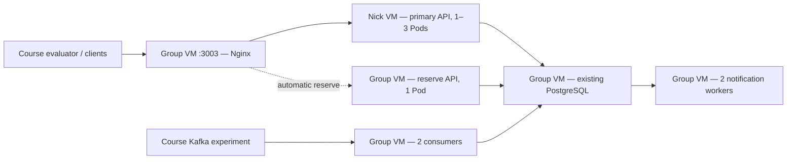

# Grafana latency follow-up — 23 October 2026

## Reading the supplied screenshots

The REST histogram's horizontal labels are seconds. Its fourth column, labelled `0.05`, contains **3133 requests between 25 and 50 milliseconds**. The number above a column counts requests; it is not a duration. The supplied REST screenshot has 8874 requests in total: approximately 61.0% at or below 50 ms, 83.2% at or below 100 ms, 99.5% at or below 250 ms, and all at or below 500 ms. Both REST error panels show zero.

The notification screenshot is already at the leftmost bucket: all **182 required notifications** were received within the 0–1 second interval, with zero missing notifications and zero hash errors. This panel is distinct from the REST response-time histogram.

The course `observability/group_personal.json` configuration was inspected on the group VM. The response histogram uses `http_load_generator_response_rtt_histogram_bucket`, with a colour threshold of **80 on the bucket count**. A tall red column therefore does not directly indicate a failed latency objective. No dashboard, colour, validation, source timestamp or evaluator setting was changed.

The memory axis is automatically zoomed and rounds its labels to 1.72 GiB. A small change can fill the panel height. The independent node metrics showed about 19 MiB spread over the first measured 15-minute window; a later window showed about 30 MiB. This is not evidence of an unbounded memory leak. It also does not establish long-term memory stability. A longer matched soak remains appropriate. Total usable group VM memory is about 3.76 GiB, with approximately 2 GiB available during inspection.

Kubernetes adds real CPU and memory overhead. Part of the increased baseline is its control plane and runtime management. It should not be described as a free performance or cost improvement.

## Diagnosis

The live API metrics initially showed mean ASGI processing around **0.9 ms**. Approximately **99%** of requests were in the application histogram's <=5 ms bucket. This metric starts after the server begins handling an ASGI request; it does not include all socket, protocol, scheduler or caller waiting time.

At the same time, the course-side five-minute histogram reported approximately **46.6 ms mean RTT** and an interpolated **191 ms p95**. Its RTT includes work outside the application middleware. These metrics cannot be equated, and their percentiles cannot be subtracted to obtain a precise per-stage p95.

A separate VM queried the same preserved, completed histories and checked every returned JSON body:

| Serial path, 300 requests each | Mean | p95 |
| --- | ---: | ---: |
| Direct API Pod | 1.67 ms | 3.69 ms |
| Gateway Pod | 1.40 ms | 2.42 ms |
| Group private NodePort | 1.28 ms | 2.20 ms |
| Group public address | 1.88 ms | 2.91 ms |

These were sequential trials during concurrent course activity; tiny differences between them are not proof that adding a network hop makes a request faster. They establish that the ordinary serial path is low-millisecond, not tens of milliseconds on every request.

At **80 requests/second** on the public API:

| Arrival pattern | Mean | p95 | Correct |
| --- | ---: | ---: | ---: |
| Evenly spaced | 2.91 ms | 6.99 ms | 1200/1200 |
| One-second batches, up to 50 in flight | 49.03 ms | 104.91 ms | 1200/1200 |

The course requestor source also schedules batches. Matching requests/second alone does not match the arrival pattern. These trials did not alter the instructor's generator.

A three-second CPU sample found Docker/containerd runtime processes consuming roughly 31% of one CPU core combined, plus K3s server activity. CPU-pressure waiting was around 30%, while average whole-VM utilization was below 50%. Container CFS quota statistics did not show significant API/gateway throttling; steal time was around 1%. These are short observations, not a proof of a universal root cause. They motivated testing API placement outside the group control-plane/database host.

## Compared configurations

The application code and API image stayed **unchanged**: `group17/temperature-api:final-v2`. Only deployment placement, CPU request and gateway routing were varied. The second node already existed; no EC2 VM was purchased or resized. Read-only access to the same PostgreSQL database was used.

| Burst80 trial | Mean | p95 | Correct |
| --- | ---: | ---: | ---: |
| Original two group API Pods, ABBA reference 1 | 46.78 ms | 148.62 ms | 1200/1200 |
| Original two group API Pods, ABBA reference 2 | 45.43 ms | 116.24 ms | 1200/1200 |
| Two API Pods on Nick, comparison 1 | 22.28 ms | 69.45 ms | 1200/1200 |
| Two API Pods on Nick, comparison 2 | 19.98 ms | 40.01 ms | 1200/1200 |
| One API Pod on Nick, comparison 1 | 20.95 ms | 42.76 ms | 1200/1200 |
| One API Pod on Nick, comparison 2 | 19.10 ms | 37.83 ms | 1200/1200 |
| Active routing 4:1 between Nick/group, comparison 1 | 59.40 ms | 160.13 ms | 1200/1200 |
| Active routing 4:1 between Nick/group, comparison 2 | 21.78 ms | 54.04 ms | 1200/1200 |

The 4:1 variant had an inconsistent tail, including a cold group API. It was not selected. One Nick API matched or improved the tested two-Nick configuration with less application memory. The selected layout therefore uses one normal primary and one group reserve instead of adding a third API process.

The reference and candidate tests share the live database and variable course traffic. The ABBA order and repeats reduce comparison bias but do not make this an isolated laboratory or prove a global optimum. The load client is on Nick, as is the new primary, but requests still travel through the group VM gateway. Frozen completed histories were used, not live-history stress data.

## Applied deployment



- `api`: primary pinned to `nick-client4`, CPU request 400m, one minimum replica; HPA can grow it to three.
- `api-reserve`: one Pod pinned to `group17`, same image and read-only DB credentials; normal user traffic goes to the primary.
- Nginx uses the reserve if primary peers are unavailable. DNS refresh, keepalive, graceful API draining and safe GET retries remain. Five retry attempts cover the maximum three primary peers plus the reserve; total retry window is five seconds.
- The course CPU/memory panels still cover the **group VM**, while the primary now also consumes Nick VM resources. A lower group-only graph does not prove lower total resource use or a lower AWS bill. Compare both nodes for a cluster-wide claim.

- The minimum remains **two API processes total**, now across two VMs. Maximum with HPA is four total. CPU request is a scheduling/share setting, not a claim that 400m is continuously consumed or an extra physical CPU.
- The API disruption budget selects both roles and keeps at least one available.
- A configuration checksum triggers gateway rollout when the generated Nginx ConfigMap changes.
- Kafka topic/group, consumers, notification workers, PostgreSQL data and external endpoint URLs are unchanged.

The change was server-dry-run validated and deployed with the group reserve ready first. The cutover helper retains an automatic return to the previous manifest if startup fails. Temporary comparison Deployments/Services were removed afterward.

## Final checks on the public API

| Deployed public endpoint profile | Mean | p95 | Correct / errors |
| --- | ---: | ---: | ---: |
| Burst80, repetition 1 | 22.54 ms | 47.89 ms | 1200 / 0 |
| Burst80, repetition 2 | 18.61 ms | 37.15 ms | 1200 / 0 |
| Burst250, 20 seconds | 21.02 ms | 60.38 ms | 5000 / 0 |

All **7400** final public responses matched the stored histories. The 80 req/s p95 reduction relative to the repeated reference is approximately **2.4–4.0 times**; this is a result for the tested burst profile, not every possible workload.

The reference had 66–69% of response headers within 50 ms. After deployment, the two Burst80 repeats had **96.9% and 99.7% within 50 ms**. Only about 1% were within 5 ms under this burst profile. The improvement must not be advertised as every request taking less than five milliseconds.

A separate **7500-request** shadow test explicitly scaled the primary API to zero. Nginx served the group reserve: all bodies remained correct, zero errors, p95 93.52 ms and maximum 207 ms. This tests graceful Pod removal and routing failover. It does not simulate power loss, loss of the physical node, or failure of PostgreSQL.

All nine final application/monitoring Pods were Ready; the working notification queue was empty; all five Prometheus targets were up. The 3045 approved quarantined records remain unsent and paused. The API/notification/aggregation code and its earlier 30 contract/unit checks were not modified in this iteration; this deployment change was checked through live response validation, failover and the server-side manifest validation.

The independent Grafana query returned **no fresh group17 RTT series** at the final check. The new course-side histogram improvement has therefore **not yet been demonstrated**. The controlled public-endpoint results above are the evidence available now. Wait for fresh evaluator traffic and compare the same time window/load before claiming a course-dashboard result. No instructor data was reset to make a chart look better.

## Operate and inspect

On the group VM:

```bash
cd ~/group17-latency-work
sudo k3s kubectl -n temperature get pods -o wide
sudo k3s kubectl -n temperature get hpa,pdb
sudo k3s kubectl -n temperature top pods
python3 scripts/verify_runtime.py
curl -fsS http://127.0.0.1:3003/health
```

Keep the Nick VM running for the fast primary. The group reserve handles loss of primary service; it shares resources with the database, control plane and event processing and can have a different latency profile.

For future releases, build/import the exact new API image on **both nodes before applying manifests**. A new Git clone or deploy key does not distribute container images. See the updated [runbook](final-kubernetes-runbook.md).

All summaries, compressed request traces, before/after course queries and runtime snapshots are in [grafana-latency-evidence](grafana-latency-evidence/). The earlier `reserve-80` test overlapped the subsequent failover client's start and is retained as a mixed diagnostic, not used as an independent steady-primary benchmark.

Technical references: [Kubernetes resource requests](https://kubernetes.io/docs/concepts/configuration/manage-resources-containers/), [Kubernetes scheduling across nodes](https://kubernetes.io/docs/concepts/scheduling-eviction/topology-spread-constraints/), [Nginx upstream and backup servers](https://nginx.org/en/docs/http/ngx_http_upstream_module.html).
